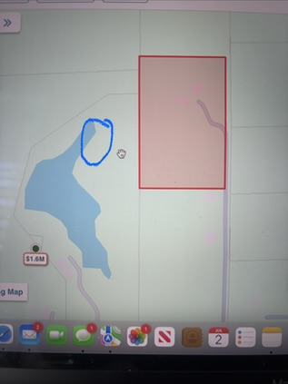
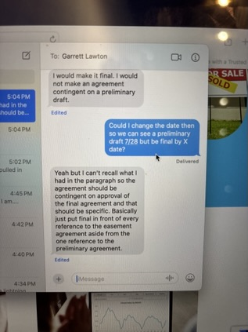
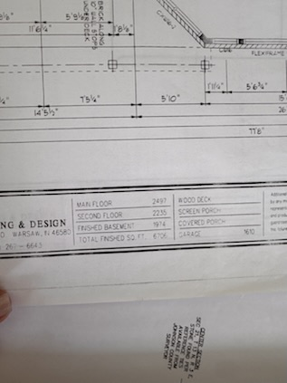

# SMS / iMessage archive — Darcy

**Source PDF:** `iphone_darcy.pdf`
**Messages represented:** 293
**Conversation:** Regina ↔ Darcy
**Order:** As exported by TextPort, earliest first
**Time zone:** Not specified in the PDF; do not assume UTC
**Evidence note:** TextPort may repeat rounded timestamps across distinct messages. No exact seconds or missing timestamps have been inferred.
**Attachment note:** Bracketed image/document descriptions are preserved, but are not the actual original attachments. The PDF may omit their content.
**Provenance:** Keep the original PDF and, preferably, the native phone export.

---

## Message 0001 — 2026-06-25 19:48
**From:** Regina  
**To:** Darcy  
**Source:** PDF page 1

https://www.zillow.com/homedetails/5306-State-Road-144- Greenwood-IN-46143/204105743_zpid/? utm_campaign=iosappmessage&utm_medium=referral&utm_source =txtshare

---

## Message 0002 — 2026-06-25 19:48
**From:** Regina  
**To:** Darcy  
**Source:** PDF page 1

Hi Darcy,

Hope you are doing well! It’s Regina and Sam.

Back in the market again and have expanded the search area. Is Greenwood a location you still service?

Have a good evening and no need to respond tonight. 🤩

---

## Message 0003 — 2026-06-25 19:51
**From:** Darcy  
**To:** Regina  
**Source:** PDF page 1

HII!!! I am so very happy you reached out to me. I have thought of you guys and then chickened out about contacting you bc I figured you had moved on and I was embarrassed for my lack of communciation! I would be happy to help you. Greenwood is doable for me 😊 But….I am leaving tomorrow for a week for Florida for family vacation. Let me check this out real quick and then I will see if Jack has time to do a FaceTime. Are you still in FL? or did you sell and come North?

---

## Message 0004 — 2026-06-25 19:55
**From:** Darcy  
**To:** Regina  
**Source:** PDF page 1

Its been on the market a little while so it shouldn’t sell overnight or anything before you could see it!

---

## Message 0005 — 2026-06-25 20:04
**From:** Regina  
**To:** Darcy  
**Source:** PDF page 2

Hi oh my gosh me and you had the same mindset haha but I was like screw it im gonna see if she will respond 🤣 so I’m thankful you did!!

We are still in FL. Getting married in a few weeks!!! We have been prepping this house here to sell but are ready to move to Indiana before it gets cold again.

We would be willing to do FaceTime walk through asap for it with Jack or someone if you aren’t available in the meantime.

Have fun in FL! It’s been so hot here

---

## Message 0006 — 2026-06-26 11:55
**From:** Regina  
**To:** Darcy  
**Source:** PDF page 2

Hi just wanted to touch base and see if that FaceTime would be possible with Jack.

I know you are traveling to Florida today so no rush or anything but just wanted to see :)

---

## Message 0007 — 2026-06-26 14:28
**From:** Darcy  
**To:** Regina  
**Source:** PDF page 2

Does 12:30 Sunday work?

---

## Message 0008 — 2026-06-26 14:29
**From:** Regina  
**To:** Darcy  
**Source:** PDF page 2

12:30 Sunday works for us!!

---

## Message 0009 — 2026-06-27 21:42
**From:** Darcy  
**To:** Regina  
**Source:** PDF page 2

Here is Jack’s number 574-527-0370. He will call you around 12:30. Sorry, I thought confirmed 12:30, but I didn’t. That time still works?!

---

## Message 0010 — 2026-06-27 21:58
**From:** Regina  
**To:** Darcy  
**Source:** PDF page 2

Loved “Here is Jack’s number 574-527-0370. He will call you around 12:30. Sorry, I thought confirmed 12:30, but I didn’t. That time still works?!”

---

## Message 0011 — 2026-06-27 21:59
**From:** Regina  
**To:** Darcy  
**Source:** PDF page 3

Thank you! That’s perfect

---

## Message 0012 — 2026-06-28 11:00
**From:** Darcy  
**To:** Regina  
**Source:** PDF page 3

Jack will probably call or text first. Let me know how it goes!

---

## Message 0013 — 2026-06-28 11:03
**From:** Regina  
**To:** Darcy  
**Source:** PDF page 3

He’s already been in touch thank you!!

---

## Message 0014 — 2026-06-29 12:04
**From:** Darcy  
**To:** Regina  
**Source:** PDF page 3

Hello! What did you guys think of the home yesterday?

---

## Message 0015 — 2026-06-29 12:10
**From:** Regina  
**To:** Darcy  
**Source:** PDF page 3

Hi! Sorry we had a family emergency yesterday and have been unable to reach out.

We LOVED the property though. Can you email me all the detailed information for the listing when you have a moment ?

---

## Message 0016 — 2026-06-29 15:52
**From:** Regina  
**To:** Darcy  
**Source:** PDF page 3

I actually found all that on our portal! We wanna put an offer in on it!

---

## Message 0017 — 2026-06-29 15:55
**From:** Darcy  
**To:** Regina  
**Source:** PDF page 3

Okay! Sorry…I am on my way back from Gainesville (took my son to see U of Florida) I will be home in a little less than 2 hours. Could we chat around 7-8?? Or if another time is best? Would you ask Sam if he could get a letter for proof of funds from his financial guy or will you do financing?

---

## Message 0018 — 2026-06-29 16:02
**From:** Regina  
**To:** Darcy  
**Source:** PDF page 4

Yes no rush, as long as Nobody else is eyeing the property we can discuss more tomorrow. Sam will message financial advisor and we will have the proof of funds.

I think we want to get the entire property and the owner Derrick mention it would be at 2.8 for the entire property and to privatize the pond. We will most likely put an all cash offer in around 2.5 but wanna check with advisor first on that but believe that’s the route we want to take!

Safe travels home and talk soon!

---

## Message 0019 — 2026-06-29 16:05
**From:** Darcy  
**To:** Regina  
**Source:** PDF page 4

Okay. The owner actually text me earlier too for feedback so I just asked if he has any serious interest at the moment Yes, Jack told me 2.8 for it all. I will verify all this too Do you want to do a specific time tomorrow ? Did you see sellers disclosure from portal?

---

## Message 0020 — 2026-06-29 16:08
**From:** Regina  
**To:** Darcy  
**Source:** PDF page 4

We do see sellers disclosure, looks good!

Can you also ask Derrick what the general utilities costs are monthly for the property if he is allowed to share that with us.

Time tomorrow we can do 1pm if that works for you?

---

## Message 0021 — 2026-06-29 16:08
**From:** Darcy  
**To:** Regina  
**Source:** PDF page 4

From seller:

We might hear from another couple but it's less likely at the moment. We have one more showing tomorrow.

---

## Message 0022 — 2026-06-29 16:09
**From:** Regina  
**To:** Darcy  
**Source:** PDF page 4

Ok thank you!! Ahh I really hope we get it. It’s exactly what we have been looking for

---

## Message 0023 — 2026-06-29 16:17
**From:** Darcy  
**To:** Regina  
**Source:** PDF page 5

Absolutely.

Electric - $440 a month for the home and then usually $35 to $40 a month for the building. Gas - at the most $100 in the winter for the home and 45 or less for building. Trash $65 for 3 months. Water - $70-90 a month. Fiber internet $69 a month. Keep in mind we have 8,550  sq ft and 3 HVAC units, hot tub and pool running in the summer.

---

## Message 0024 — 2026-06-29 16:19
**From:** Regina  
**To:** Darcy  
**Source:** PDF page 5

Loved “Absolutely.

Electric - $440 a month for the home and then usually $35 to $40 a month for the building. Gas - at the most $100 in the winter for the home and 45 or less for building. Trash $65 for 3 months. Water - $70-90 a month. Fiber internet $69 a month. Keep in mind we have 8,550  sq ft and 3 HVAC units, hot tub and pool running in the summer.”

---

## Message 0025 — 2026-06-29 16:19
**From:** Regina  
**To:** Darcy  
**Source:** PDF page 5

Ok nice thank you!

---

## Message 0026 — 2026-06-29 16:20
**From:** Darcy  
**To:** Regina  
**Source:** PDF page 5

I need to send Sam a Buyers agency agreement… 😊 I forgot about that the other day. I will just do specific to this property for 50 days. Or is it going into both your names?

---

## Message 0027 — 2026-06-29 16:21
**From:** Regina  
**To:** Darcy  
**Source:** PDF page 5

I think it will be placed under the trust and sounds good! I’ll let him know to look out for that :)

---

## Message 0028 — 2026-06-29 19:39
**From:** Darcy  
**To:** Regina  
**Source:** PDF page 5

Just emailed to Sam! Did about 50 days and I put 2% in for commission, if they won’t pay that much, I will adjust! 😊

---

## Message 0029 — 2026-06-29 19:39
**From:** Darcy  
**To:** Regina  
**Source:** PDF page 6

Talk to you tomorrow at 1

---

## Message 0030 — 2026-06-30 12:22
**From:** Regina  
**To:** Darcy  
**Source:** PDF page 6

Talk soon! 😊 got approval from financial advisor waiting on the proof of funds email now!

---

## Message 0031 — 2026-06-30 12:23
**From:** Darcy  
**To:** Regina  
**Source:** PDF page 6

Okay. Fyi I am ready when you are if you want to talk before 1. But I understand Sam might be busy Came inside to a beach restaurant bc I am dying from the heat 🙃

---

## Message 0032 — 2026-06-30 12:25
**From:** Regina  
**To:** Darcy  
**Source:** PDF page 6

Haha oh my gosh it’s been soooo hot so totally understand.

We are eating at the moment but can call soon!

---

## Message 0033 — 2026-06-30 13:00
**From:** Regina  
**To:** Darcy  
**Source:** PDF page 6

Calling shortly

---

## Message 0034 — 2026-06-30 14:32
**From:** Darcy  
**To:** Regina  
**Source:** PDF page 6

He is talking to his wife at 3 when she gets home He did ask if we close end of July would you let them have possession for a week longer (totally normal and acceptable to do, kind of anti climactic when closing and not moving right away) but if it gets the deal done for $2.5, it would be worth it!

---

## Message 0035 — 2026-06-30 14:34
**From:** Regina  
**To:** Darcy  
**Source:** PDF page 6

Yeah we aren’t in any rush to move just rush on securing the property before others! ❤

---

## Message 0036 — 2026-06-30 14:36
**From:** Regina  
**To:** Darcy  
**Source:** PDF page 6

As long as we get done in august as Sam and I will be gone on our honeymoon Sept. 1-22nd and won’t be available to do anything that month.

---

## Message 0037 — 2026-06-30 14:36
**From:** Darcy  
**To:** Regina  
**Source:** PDF page 7

Liked “As long as we get done in august as Sam and I will be gone on our honeymoon Sept. 1-22nd and won’t be available to do anything that month.”

---

## Message 0038 — 2026-06-30 16:38
**From:** Darcy  
**To:** Regina  
**Source:** PDF page 7

If we had actually submitted an offer….they would counter back at $2.7. He obviously justified the price to me :) Okay with a closing around 7/30 or 31, unless you rather close the following week. Not sure when you get back from Anguilla?

Talk it over and let me know which way you want to proceed!

---

## Message 0039 — 2026-06-30 17:01
**From:** Regina  
**To:** Darcy  
**Source:** PDF page 7

Let’s do 2.15 all cash with shared lot and closing 7/31 ❤ For first official offer

2.7 is a more than we wanna spend right now. Still gonna furnish that place haha.

Yayy excited!!!!

---

## Message 0040 — 2026-06-30 17:04
**From:** Regina  
**To:** Darcy  
**Source:** PDF page 7

Sam and I will be unavailable for wedding events 7/10-712

And then 7/16-7/21

---

## Message 0041 — 2026-06-30 17:09
**From:** Darcy  
**To:** Regina  
**Source:** PDF page 7

Thank you on dates! Okay on offer I just left for my middles 15th birthday dinner at the Ugly Grouper but will get it all situated and sent over this evening for signatures Just going to put in Sam’s name  and then when you get the trust situated we can do an amendment putting into the trust. Will text before I send

---

## Message 0042 — 2026-06-30 17:11
**From:** Regina  
**To:** Darcy  
**Source:** PDF page 7

No worries and sounds good. I will say you are good to use the trust name used previously. Should be good to go with that but can put in Sam’s name for now if needed!

---

## Message 0043 — 2026-06-30 17:17
**From:** Darcy  
**To:** Regina  
**Source:** PDF page 8

Oh! Thats right. Will do :)

---

## Message 0044 — 2026-06-30 17:18
**From:** Regina  
**To:** Darcy  
**Source:** PDF page 8

Loved “Oh! Thats right. Will do :)”

---

## Message 0045 — 2026-06-30 20:39
**From:** Darcy  
**To:** Regina  
**Source:** PDF page 8

Okay…stay tuned buying a parcel and then splitting it before it’s actually purchased could be problematic. By problematic I mean an attorney may need to get involved. I used AI to help me write the contingencies in for the actual splitting of the parcel, the taxes on the parcel and then the pond maintenance I sent it to my owner and our managing broker. The owner said it probably needed an attorney Waiting to see what my broker says. 😬 Honestly..the seller should have just split before selling or sell it all together! I want to make sure you (and me) are both fully covered

---

## Message 0046 — 2026-06-30 20:41
**From:** Regina  
**To:** Darcy  
**Source:** PDF page 8

Thank you for doing your due diligence on that for you and for us!!! Just let us know and appreciate you.

Sorry to be doing this while you’re on vacation!!!

---

## Message 0047 — 2026-06-30 20:48
**From:** Darcy  
**To:** Regina  
**Source:** PDF page 8

Okay my broker told me I sounded like a lawyer 🙃 and I could get in trouble for “practicing law.” So….let me also let Derrick the seller know all this and see what he says. Maybe he would start the split right away and we can see how long it will take and see what kind of promise he can make us to sell it to us….. Or maybe he will give in and sell it all for 2.5!!

---

## Message 0048 — 2026-06-30 20:53
**From:** Regina  
**To:** Darcy  
**Source:** PDF page 8

Ok sounds good to us and seems we are on the same page with thoughts on this. Appreciate you!

---

## Message 0049 — 2026-07-01 08:01
**From:** Darcy  
**To:** Regina  
**Source:** PDF page 9

From the seller

Good morning,

I wanted to let you and the buyers know that we are working on few things but it will require us to involve 3 other people to ensure we have all angles covered. If it is okay I likely will be back in touch around mid afternoon and for sure before 5?

---

## Message 0050 — 2026-07-01 09:54
**From:** Regina  
**To:** Darcy  
**Source:** PDF page 9

Yeah that is ok with us. Thank you!

---

## Message 0051 — 2026-07-01 09:58
**From:** Regina  
**To:** Darcy  
**Source:** PDF page 9

Also I can share with you proof of purchase if needed!

---

## Message 0052 — 2026-07-01 10:57
**From:** Regina  
**To:** Darcy  
**Source:** PDF page 9

I think Sam is wanting to come in person and see the property himself. If we fly in tomorrow could we see the property Friday?

---

## Message 0053 — 2026-07-01 11:33
**From:** Regina  
**To:** Darcy  
**Source:** PDF page 9

We could be in town Friday 11am - 5pm if that could work for them we will book our tickets now. Thank you

---

## Message 0054 — 2026-07-01 11:47
**From:** Darcy  
**To:** Regina  
**Source:** PDF page 9

I should be able to find someone to go with you Friday! I won’t be home until Sunday Sorry we were kayaking and looking for manatees….I am not going to be able to lift my arms tomorrow 🙃

---

## Message 0055 — 2026-07-01 11:48
**From:** Regina  
**To:** Darcy  
**Source:** PDF page 9

Hahaha oh my gosh I bet that was so fun!! 🤩 but yes the soreness is serious haha

Yay for Friday. We will book tickets now

---

## Message 0056 — 2026-07-01 12:14
**From:** Regina  
**To:** Darcy  
**Source:** PDF page 10

When you have the chance can we confirm with the owner that Friday works for them?

---

## Message 0057 — 2026-07-01 12:39
**From:** Darcy  
**To:** Regina  
**Source:** PDF page 10

Owner is checking w wife as apparently Friday is their anniversary. I told him he didn’t need to be there but…I am guessing he likes to be there

---

## Message 0058 — 2026-07-01 12:46
**From:** Regina  
**To:** Darcy  
**Source:** PDF page 10

Loved “Owner is checking w wife as apparently Friday is their anniversary. I told him he didn’t need to be there but…I am guessing he likes to be there”

---

## Message 0059 — 2026-07-01 12:48
**From:** Regina  
**To:** Darcy  
**Source:** PDF page 10

I just don’t know if we can come again until after the wedding if we can’t come Friday.. I hope it works out 🙏

---

## Message 0060 — 2026-07-01 15:34
**From:** Darcy  
**To:** Regina  
**Source:** PDF page 10

Just sent you an email! I am sure Friday will work out either w Jake or the owner himself.

---

## Message 0061 — 2026-07-01 15:43
**From:** Regina  
**To:** Darcy  
**Source:** PDF page 10

Perfect thank you!

---

## Message 0062 — 2026-07-01 15:54
**From:** Regina  
**To:** Darcy  
**Source:** PDF page 10

When you’re available we would love chat! Have a few opinions and questions about the offer.

---

## Message 0063 — 2026-07-01 15:54
**From:** Regina  
**To:** Darcy  
**Source:** PDF page 10

I will be unavailable between 5-6

---

## Message 0064 — 2026-07-01 15:55
**From:** Darcy  
**To:** Regina  
**Source:** PDF page 10

Okay, I am still at the beach and I really want to read it from my computer!!! so let’s plan at least around 6:30…getting into dinner but I will figure it out.

---

## Message 0065 — 2026-07-01 15:57
**From:** Regina  
**To:** Darcy  
**Source:** PDF page 11

Perfect! No rush for us and hope you enjoy the beach ❤

---

## Message 0066 — 2026-07-01 18:20
**From:** Regina  
**To:** Darcy  
**Source:** PDF page 11

You’re welcome to call whenever you are ready! No rush

---

## Message 0067 — 2026-07-01 18:25
**From:** Darcy  
**To:** Regina  
**Source:** PDF page 11

I a ready when you are! I have family pictures at 7 that I found out about around 4:45…. 🤪

---

## Message 0068 — 2026-07-01 18:38
**From:** Regina  
**To:** Darcy  
**Source:** PDF page 11

We are still on for Friday for a visit! Btw!!!

---

## Message 0069 — 2026-07-01 18:39
**From:** Darcy  
**To:** Regina  
**Source:** PDF page 11

Okay!

---

## Message 0070 — 2026-07-01 18:39
**From:** Regina  
**To:** Darcy  
**Source:** PDF page 11

At most we would do 2.55 if needed for fully private

---

## Message 0071 — 2026-07-01 20:17
**From:** Regina  
**To:** Darcy  
**Source:** PDF page 11

We will be in Indiana Friday and available from 11am until 5pm.

---

## Message 0072 — 2026-07-02 10:03
**From:** Darcy  
**To:** Regina  
**Source:** PDF page 11

Okay, they really just want access to  that way back part of the lake to fish. Since they wanted to put a small dock in, it makes sense for the easement-they said they didn’t want to see you guys as they were sure you wouldn’t want to see them either 😂 They would absolutely end the agreement if they moved. Wondered though if one of their children bought the property if that was okay? As long as the home was “in the family” otherwise the easement would end upon selling. Sending a pic…the red is what they are buying which is why that easement on that side. I circled (sort of) the end of the lake they want to use. Apparently there is a small stream that goes from the lake to the new property they want to buy.

---

## Message 0073 — 2026-07-02 10:04
**From:** Darcy  
**To:** Regina  
**Source:** PDF page 12

---

## Message 0074 — 2026-07-02 10:39
**From:** Regina  
**To:** Darcy  
**Source:** PDF page 12

We are good with all of that and if they sale to another family member we would be happy to discuss continuing the easement or starting a new one with them if/when needed.

Is this for the 2.5 price?

And are what time tomorrow would be best to view the property?

---

## Message 0075 — 2026-07-02 10:40
**From:** Regina  
**To:** Darcy  
**Source:** PDF page 12

Loved “Okay, they really just want access to  that way back part of the lake to fish. Since they wanted to put a small dock in, it makes sense for the easement-they said they didn’t want to see you guys as they were sure you wouldn’t want to see them either 😂 They would absolutely end the agreement if they moved. Wondered though if one of their children bought the property if that was okay? As long as the home was “in the family” otherwise the easement would end upon selling. Sending a pic…the red is what they are buying which is why that easement on that side. I circled (sort of) the end of the lake they want to use. Apparently there is a small stream that goes from the lake to the new property they want to buy.”

---

## Message 0076 — 2026-07-02 11:00
**From:** Darcy  
**To:** Regina  
**Source:** PDF page 13

All property, $2.5M minus the easement which will run with the land as long as the Hasenour’s own it

They said 2 tomorrow and then asked about 1. Jack was ready for 2, checking w him about 1 🙃 Since Derrick would be there it would be okay without Jack but I feel better about being “represented.”

---

## Message 0077 — 2026-07-02 11:03
**From:** Regina  
**To:** Darcy  
**Source:** PDF page 13

Yeah i definitely agree on having Jack with us. We are good for either times and sounds good to us 🤩

Thank you so much Darcy!!

Hopefully third times a charm for us hahaha

---

## Message 0078 — 2026-07-02 11:22
**From:** Darcy  
**To:** Regina  
**Source:** PDF page 13

Okay, 1 pm works for Jack and owner Does that work for you?

---

## Message 0079 — 2026-07-02 11:25
**From:** Regina  
**To:** Darcy  
**Source:** PDF page 13

That works for us! We will see them there.

---

## Message 0080 — 2026-07-02 11:25
**From:** Darcy  
**To:** Regina  
**Source:** PDF page 13

Liked “That works for us! We will see them there. ”

---

## Message 0081 — 2026-07-03 11:22
**From:** Darcy  
**To:** Regina  
**Source:** PDF page 13

Still good for 1? Just double checking :)

---

## Message 0082 — 2026-07-03 11:23
**From:** Regina  
**To:** Darcy  
**Source:** PDF page 13

Yes we are!! Made it to Indy about not long ago

---

## Message 0083 — 2026-07-03 14:26
**From:** Regina  
**To:** Darcy  
**Source:** PDF page 13

We want to put an offer in at 2.5!

---

## Message 0084 — 2026-07-03 14:26
**From:** Darcy  
**To:** Regina  
**Source:** PDF page 14

Okay, so 2.5 and allow an easement?

---

## Message 0085 — 2026-07-03 14:27
**From:** Regina  
**To:** Darcy  
**Source:** PDF page 14

We are gonna debrief but it seems likely we are gonna move forward. And yes. Text you shortly!

---

## Message 0086 — 2026-07-03 14:27
**From:** Darcy  
**To:** Regina  
**Source:** PDF page 14

Okay.

---

## Message 0087 — 2026-07-03 14:44
**From:** Regina  
**To:** Darcy  
**Source:** PDF page 14

Ok we are in! 2.5 entire property with easement.

We talked about buying the pool table and possible other furnishings. Not sure how we wanna handle that part!

Loved the house so much

---

## Message 0088 — 2026-07-03 14:56
**From:** Darcy  
**To:** Regina  
**Source:** PDF page 14

Okay. I will get it typed up and send as pdf first so you can view it. Technically in a cash offer we can put all that in our offer (personal property) so….if you know what you want we can add it and a price or we can just wait until we get the deal done and do a personal property agreement. Depending on how much stuff you want…or how soon you want me to get the offer written!!

---

## Message 0089 — 2026-07-03 15:00
**From:** Regina  
**To:** Darcy  
**Source:** PDF page 14

Let’s do the personal property agreement after! Thank you!!

---

## Message 0090 — 2026-07-03 15:05
**From:** Darcy  
**To:** Regina  
**Source:** PDF page 14

I for some reason am not finding my email w Sam’s Trust name from last year…can you tell me what it is if you know off the top of your head?

---

## Message 0091 — 2026-07-03 15:06
**From:** Darcy  
**To:** Regina  
**Source:** PDF page 14

Email me proof of funds too when you have a moment t

---

## Message 0092 — 2026-07-03 15:10
**From:** Regina  
**To:** Darcy  
**Source:** PDF page 15

[Attachment unavailable]

---

## Message 0093 — 2026-07-03 15:12
**From:** Regina  
**To:** Darcy  
**Source:** PDF page 15

Samuel G. Presnal Trust

---

## Message 0094 — 2026-07-03 15:12
**From:** Regina  
**To:** Darcy  
**Source:** PDF page 15

Do we need to get a new proof of funds that reflects the 2.5?

---

## Message 0095 — 2026-07-03 15:12
**From:** Regina  
**To:** Darcy  
**Source:** PDF page 15

Oh sorry just saw where you said email proof.. I can do that if needed

---

## Message 0096 — 2026-07-03 15:12
**From:** Darcy  
**To:** Regina  
**Source:** PDF page 15

I will send that one first and put in the out agreement we have one business day to get. That way if he wants a 2.5 we can do on Monday

---

## Message 0097 — 2026-07-03 15:12
**From:** Darcy  
**To:** Regina  
**Source:** PDF page 15

Nope! I got from text :)

---

## Message 0098 — 2026-07-03 15:13
**From:** Regina  
**To:** Darcy  
**Source:** PDF page 15

Perfect! Sounds good 💕

---

## Message 0099 — 2026-07-03 15:13
**From:** Regina  
**To:** Darcy  
**Source:** PDF page 15

Thank you

---

## Message 0100 — 2026-07-03 15:48
**From:** Darcy  
**To:** Regina  
**Source:** PDF page 15

If close 7/31 is a move out date for them of 8/7 okay? Since they need the $ to buy the other place but some time to move out. But you can also start moving in they said 🙃 they just won’t be out all the way We will do a post closing possession that is a legal document for if something were to happen.

---

## Message 0101 — 2026-07-03 15:48
**From:** Darcy  
**To:** Regina  
**Source:** PDF page 15

I sent an email w purchase agreement draft to look over

---

## Message 0102 — 2026-07-03 15:55
**From:** Regina  
**To:** Darcy  
**Source:** PDF page 16

I would say all looks good to us!! We won’t need to move in immediately. Probably mid august before we even get started with moving and then will be gone until end of sept.

---

## Message 0103 — 2026-07-03 15:56
**From:** Darcy  
**To:** Regina  
**Source:** PDF page 16

Okay, sounds good!

---

## Message 0104 — 2026-07-03 16:14
**From:** Darcy  
**To:** Regina  
**Source:** PDF page 16

Are you flying home tonight?

---

## Message 0105 — 2026-07-03 16:15
**From:** Regina  
**To:** Darcy  
**Source:** PDF page 16

We fly back out at 7 and land at 10pm.

---

## Message 0106 — 2026-07-03 16:15
**From:** Darcy  
**To:** Regina  
**Source:** PDF page 16

Allegiant? If so…I am coming in on the flight from Sarasota! 😁

---

## Message 0107 — 2026-07-03 16:19
**From:** Regina  
**To:** Darcy  
**Source:** PDF page 16

Oh my gosh haha 🤣 that’s so funny.

Sam said keep are seats warm for us 🤣

---

## Message 0108 — 2026-07-03 16:24
**From:** Regina  
**To:** Darcy  
**Source:** PDF page 16

Also safe travels!

---

## Message 0109 — 2026-07-03 16:25
**From:** Darcy  
**To:** Regina  
**Source:** PDF page 16

Thanks, you too! I did send those docs before I got on the plane but I won’t send until I land so just sign whenever. If you have questions just wait for me to land! :)

---

## Message 0110 — 2026-07-03 16:29
**From:** Regina  
**To:** Darcy  
**Source:** PDF page 16

Loved “Thanks, you too! I did send those docs before I got on the plane but I won’t send until I land so just sign whenever. If you have questions just wait for me to land! :)”

---

## Message 0111 — 2026-07-03 16:29
**From:** Regina  
**To:** Darcy  
**Source:** PDF page 17

Thank you, sounds good!

---

## Message 0112 — 2026-07-03 18:48
**From:** Regina  
**To:** Darcy  
**Source:** PDF page 17

Sam has a few questions

---

## Message 0113 — 2026-07-03 19:08
**From:** Regina  
**To:** Darcy  
**Source:** PDF page 17

I think we missed you

---

## Message 0114 — 2026-07-03 19:10
**From:** Darcy  
**To:** Regina  
**Source:** PDF page 17

I was looking for you but didn’t see you guys 🫤 My best friend is on the flight down there too to her parents.

---

## Message 0115 — 2026-07-03 19:11
**From:** Regina  
**To:** Darcy  
**Source:** PDF page 17

I saw you I just couldn’t get our eyes to meet 😥 and oh how fun! Sam has a few things to ask about before we sign

---

## Message 0116 — 2026-07-03 19:11
**From:** Darcy  
**To:** Regina  
**Source:** PDF page 17

I am sure we are okay to just submit tomorrow morning, I can rescind the PA and change the dates to tomorrow Or you can text me the questions?

---

## Message 0117 — 2026-07-03 19:12
**From:** Darcy  
**To:** Regina  
**Source:** PDF page 17

Or we can talk later or now!? :)

---

## Message 0118 — 2026-07-03 19:12
**From:** Darcy  
**To:** Regina  
**Source:** PDF page 17

Shoot sorry

---

## Message 0119 — 2026-07-03 19:22
**From:** Regina  
**To:** Darcy  
**Source:** PDF page 17

I’m gonna have Sam email you

---

## Message 0120 — 2026-07-03 19:23
**From:** Regina  
**To:** Darcy  
**Source:** PDF page 17

It won’t be tonight..

---

## Message 0121 — 2026-07-03 19:41
**From:** Regina  
**To:** Darcy  
**Source:** PDF page 18

Do you know any closing attorneys? Sam actually used one for the closing when he bought the FL house.

Do you think this is a good option to revisit for this sale and the easement involved?

---

## Message 0122 — 2026-07-04 11:40
**From:** Regina  
**To:** Darcy  
**Source:** PDF page 18

Hi! Are you available for a phone call sometime today or now?

---

## Message 0123 — 2026-07-04 11:41
**From:** Darcy  
**To:** Regina  
**Source:** PDF page 18

Yes, let’s do it now?!

---

## Message 0124 — 2026-07-05 16:48
**From:** Regina  
**To:** Darcy  
**Source:** PDF page 18

Hi! Thoughts on getting survey done… with the last one being in 2009 and lots of updates being made with that other lot we think it’s best but want your opinion.

We really thought a more recent one was done. Also the document with the current surveys are too blurry to read any of the smaller print.

---

## Message 0125 — 2026-07-05 17:26
**From:** Regina  
**To:** Darcy  
**Source:** PDF page 18

after we decide on this we are ready to sign purchase agreement.

---

## Message 0126 — 2026-07-05 17:31
**From:** Darcy  
**To:** Regina  
**Source:** PDF page 18

Sorry! I am digging around online. The survey is from 2009 because that is when they made Lots 1/2 a Subdivision. I am trying to find all the deeds since then to see if they all have the exact legal description. I don’t see why it would be a problem to get a survey other than it not being done on time for a 7/31 close…and I doubt the seller will pay for it.

---

## Message 0127 — 2026-07-05 17:49
**From:** Regina  
**To:** Darcy  
**Source:** PDF page 19

Ok. Sam said he is good with paying for the first survey option on purchase agreement and good to sign. How long do you think it would take to get done if we do it?

If closing date needs to be extended we don’t have issues with that.. do you think they will? We will be away all of September until the 22nd but if all could get done before last week of August that would be preferred..

Sorry, really not trying to be complicated!!

---

## Message 0128 — 2026-07-05 17:59
**From:** Darcy  
**To:** Regina  
**Source:** PDF page 19

Its okay! It’s an expensive piece of property!!! So….a Survey location report is usually only for small tracts of land. For this amount of acreage, I am fairly certain it would be a Boundary survey. 😬 This won’t be cheap for 20 acres. I do think it will be tough to get it done by 7/31 but I don’t know for sure. I think the sellers want to close  so they can close on the other property.

---

## Message 0129 — 2026-07-05 18:09
**From:** Regina  
**To:** Darcy  
**Source:** PDF page 19

Can you setup the appointment with the lawyer for tomorrow and Sam and them can discuss that and the purchase agreement

---

## Message 0130 — 2026-07-06 09:32
**From:** Darcy  
**To:** Regina  
**Source:** PDF page 19

I am working on this still!

---

## Message 0131 — 2026-07-06 13:26
**From:** Darcy  
**To:** Regina  
**Source:** PDF page 19

I sent an email w as much detail as I could but he will probably still have questions!! His cell is 317-410-8851 but might call from an office number

---

## Message 0132 — 2026-07-06 13:30
**From:** Regina  
**To:** Darcy  
**Source:** PDF page 19

Ok thank you

---

## Message 0133 — 2026-07-06 13:41
**From:** Regina  
**To:** Darcy  
**Source:** PDF page 20

Ok just spoke with lawyer and we are going to obtain him today and he said he will be able to start his review tomorrow.

Do you have a second to chat?

---

## Message 0134 — 2026-07-06 15:41
**From:** Darcy  
**To:** Regina  
**Source:** PDF page 20

Yes! Sorry

---

## Message 0135 — 2026-07-06 16:04
**From:** Regina  
**To:** Darcy  
**Source:** PDF page 20

Do you have time in the next 30?

---

## Message 0136 — 2026-07-06 16:14
**From:** Regina  
**To:** Darcy  
**Source:** PDF page 20

Or you can call when you are free. Sam and I are available :)

---

## Message 0137 — 2026-07-06 19:55
**From:** Darcy  
**To:** Regina  
**Source:** PDF page 20

Just to make sure :) the seller is questioning me.

Garrett said in his legal opinion, a new(er) survey needs done for the easement. My question to the surveyor is can an easement be done 17 years later without an updated survey or should a new one be done.

Does that sum it up correctly?

---

## Message 0138 — 2026-07-06 20:04
**From:** Regina  
**To:** Darcy  
**Source:** PDF page 20

Our take away was he highly recommends doing the survey especially since there is an easement involved. I don't know what exact words he said though. So that seems correct to us.

We haven’t heard back from Garrett today but hoping tomorrow morning we can get things going.

---

## Message 0139 — 2026-07-06 20:05
**From:** Darcy  
**To:** Regina  
**Source:** PDF page 20

Liked “Our take away was he highly recommends doing the survey especially since there is an easement involved. I don't know what exact words he said though. So that seems correct to us.

We haven’t heard back from Garrett today but hoping tomorrow morning we can get things going.”

---

## Message 0140 — 2026-07-07 10:28
**From:** Darcy  
**To:** Regina  
**Source:** PDF page 21

Have you gotten anything from Garrett yet this am?

---

## Message 0141 — 2026-07-07 10:31
**From:** Regina  
**To:** Darcy  
**Source:** PDF page 21

He just messaged and said he would send over stuff shortly… we are still waiting on him to send over contract for us to work with him.

---

## Message 0142 — 2026-07-07 10:35
**From:** Darcy  
**To:** Regina  
**Source:** PDF page 21

Liked “He just messaged and said he would send over stuff shortly… we are still waiting on him to send over contract for us to work with him. ”

---

## Message 0143 — 2026-07-07 11:45
**From:** Regina  
**To:** Darcy  
**Source:** PDF page 21

Agreement with lawyer has been signed.

---

## Message 0144 — 2026-07-07 11:47
**From:** Regina  
**To:** Darcy  
**Source:** PDF page 21

Waiting to hear from him regarding the review. Really hoping to get stuff taken care of asap. Sam and I have our courthouse wedding on Friday so we will not be available that day.

---

## Message 0145 — 2026-07-07 14:23
**From:** Regina  
**To:** Darcy  
**Source:** PDF page 21

He’s reviewing now and will be in touch shortly

---

## Message 0146 — 2026-07-07 16:46
**From:** Regina  
**To:** Darcy  
**Source:** PDF page 21

Hi are you available for a quick phone call? We just spoke to Garrett! 😊

---

## Message 0147 — 2026-07-07 16:47
**From:** Darcy  
**To:** Regina  
**Source:** PDF page 21

Yes!

---

## Message 0148 — 2026-07-07 16:59
**From:** Darcy  
**To:** Regina  
**Source:** PDF page 21

Oh! Will you call your inspector friend about doing an inspection?? If he can do 7/14 that would be super duper ideal for me!! :) Or later afternoon on the 13th!

---

## Message 0149 — 2026-07-07 16:59
**From:** Darcy  
**To:** Regina  
**Source:** PDF page 22

Just to pencil him in

---

## Message 0150 — 2026-07-07 17:02
**From:** Regina  
**To:** Darcy  
**Source:** PDF page 22

Loved “Oh! Will you call your inspector friend about doing an inspection?? If he can do 7/14 that would be super duper ideal for me!! :) Or later afternoon on the 13th!”

---

## Message 0151 — 2026-07-07 17:02
**From:** Regina  
**To:** Darcy  
**Source:** PDF page 22

I’ll ask him!!

---

## Message 0152 — 2026-07-07 17:07
**From:** Regina  
**To:** Darcy  
**Source:** PDF page 22

I went to send him the Zillow link for the property and it shows it was taken off today 😂

---

## Message 0153 — 2026-07-07 17:08
**From:** Darcy  
**To:** Regina  
**Source:** PDF page 22

His contract w the realtor ended yesterday technically. But I still need to put his name on the PA on my end bc we did all this while he was still listing agent and I honestly have no idea what arrangement they actually had…. Do you need me to send it to you?

---

## Message 0154 — 2026-07-07 17:15
**From:** Regina  
**To:** Darcy  
**Source:** PDF page 22

No it’s ok! Thank you for clarifying that!

---

## Message 0155 — 2026-07-07 17:16
**From:** Regina  
**To:** Darcy  
**Source:** PDF page 22

Bill said he is available either day for inspection :)

---

## Message 0156 — 2026-07-07 17:16
**From:** Darcy  
**To:** Regina  
**Source:** PDF page 22

Perfect, give me until tomorrow and I will tell you which day for sure! I just don’t know if am taking my oldest to camp Monday am or not…. 🤪

---

## Message 0157 — 2026-07-07 17:17
**From:** Regina  
**To:** Darcy  
**Source:** PDF page 22

No worries! We are excited. 😆

---

## Message 0158 — 2026-07-07 22:00
**From:** Darcy  
**To:** Regina  
**Source:** PDF page 23

Everything has been submitted! I did say we could get an updated Proof of funds if he needed. He said for peace of mind he would like one. So can you reach out in the am and get that updated to $2.5? Thank you!! Will let you know what he says tomorrow!

---

## Message 0159 — 2026-07-07 22:01
**From:** Regina  
**To:** Darcy  
**Source:** PDF page 23

All sounds good and we can do that. Thank you for your help!!! We appreciate it all.

---

## Message 0160 — 2026-07-08 10:26
**From:** Regina  
**To:** Darcy  
**Source:** PDF page 23

📎 Presnal.Sam - Ltr for Indiana home purchase_07.08.26-1290efc2e37e99642798c2bda86cd35993192b8 d1de7ca4fb5e243117dce9529.pdf

---

## Message 0161 — 2026-07-08 10:32
**From:** Darcy  
**To:** Regina  
**Source:** PDF page 23

Got it and sent!

---

## Message 0162 — 2026-07-08 14:12
**From:** Regina  
**To:** Darcy  
**Source:** PDF page 23

Thank you

---

## Message 0163 — 2026-07-08 14:39
**From:** Darcy  
**To:** Regina  
**Source:** PDF page 23

Just sent a counter offer 🙃

---

## Message 0164 — 2026-07-08 15:25
**From:** Regina  
**To:** Darcy  
**Source:** PDF page 23

Thank you for sending that over. I am gonna be home in the next 40 minutes. Do you wanna schedule a call around 4:30 and we can discuss it?

---

## Message 0165 — 2026-07-08 15:35
**From:** Darcy  
**To:** Regina  
**Source:** PDF page 23

Yes 4:30 works

---

## Message 0166 — 2026-07-08 15:47
**From:** Regina  
**To:** Darcy  
**Source:** PDF page 23

Liked “Yes 4:30 works”

---

## Message 0167 — 2026-07-09 09:10
**From:** Regina  
**To:** Darcy  
**Source:** PDF page 24

Hi Darcy,

Received your email this morning…. We aren’t trying to standstill anything.. and think it’s definitely best (especially with how he’s being now) that we handle this with the lawyer and wait on his review.

Sam and I have wedding meetings today at 11. Unsure when that will end but hopefully we will hear back from Garrett soon and then can move forward.

And just to note..: we never wanted the property for 2.8 or for the full property. We wanted to the 2.25 for the 13 but they didn’t have that available to sell to us… also we are requesting the easement paperwork be submitted for review prior to closing? Idk why they are making it seem so bad..

I don’t think he’s doing a good job representing themselves.

---

## Message 0168 — 2026-07-09 09:16
**From:** Darcy  
**To:** Regina  
**Source:** PDF page 24

I agree. I “assume” he meant a standstill because of the easement holding us up?! Honestly, once we see what Garrett says, it will be best to just write another offer and make it as clean as possible with everything we have talked about and they just accept instead of countering.

---

## Message 0169 — 2026-07-09 09:17
**From:** Darcy  
**To:** Regina  
**Source:** PDF page 24

I know courthouse tomorrow. When do you leave for Anguilla?

---

## Message 0170 — 2026-07-09 09:23
**From:** Regina  
**To:** Darcy  
**Source:** PDF page 24

We leave on the 16-22 for Anguilla

---

## Message 0171 — 2026-07-09 09:23
**From:** Regina  
**To:** Darcy  
**Source:** PDF page 24

Loved “I agree. I “assume” he meant a standstill because of the easement holding us up?! Honestly, once we see what Garrett says, it will be best to just write another offer and make it as clean as possible with everything we have talked about and they just accept instead of countering.”

---

## Message 0172 — 2026-07-09 09:25
**From:** Darcy  
**To:** Regina  
**Source:** PDF page 25

Thank you, I could have scrolled up….but that was easier 😊

---

## Message 0173 — 2026-07-09 09:47
**From:** Regina  
**To:** Darcy  
**Source:** PDF page 25

Loved “Thank you, I could have scrolled up….but that was easier 😊”

---

## Message 0174 — 2026-07-09 12:18
**From:** Regina  
**To:** Darcy  
**Source:** PDF page 25

You up for a call?

---

## Message 0175 — 2026-07-09 12:19
**From:** Darcy  
**To:** Regina  
**Source:** PDF page 25

Give me 15-20 ish. I am taking my middle and some friends to the fields so easier to not have anyone with me in the car!

---

## Message 0176 — 2026-07-09 12:21
**From:** Regina  
**To:** Darcy  
**Source:** PDF page 25

No worries and sounds good thank you.

---

## Message 0177 — 2026-07-09 13:19
**From:** Regina  
**To:** Darcy  
**Source:** PDF page 25

Ok Sam and I have come up with two options. Should I email or go over on the phone with you?

---

## Message 0178 — 2026-07-09 13:21
**From:** Darcy  
**To:** Regina  
**Source:** PDF page 25

I like both! Email first and then we can talk!

---

## Message 0179 — 2026-07-09 13:26
**From:** Regina  
**To:** Darcy  
**Source:** PDF page 25

Sounds good!

---

## Message 0180 — 2026-07-09 14:08
**From:** Regina  
**To:** Darcy  
**Source:** PDF page 25

Sending now

---

## Message 0181 — 2026-07-09 14:08
**From:** Regina  
**To:** Darcy  
**Source:** PDF page 25

Lmk when you review and feel free to call whenever you are available

---

## Message 0182 — 2026-07-09 15:32
**From:** Darcy  
**To:** Regina  
**Source:** PDF page 25

Just sent an email back with a highlights of a new offer

---

## Message 0183 — 2026-07-09 15:34
**From:** Regina  
**To:** Darcy  
**Source:** PDF page 26

Loved “Just sent an email back with a highlights of a new offer”

---

## Message 0184 — 2026-07-10 15:09
**From:** Regina  
**To:** Darcy  
**Source:** PDF page 26

This is so sad to see 😥

---

## Message 0185 — 2026-07-10 15:11
**From:** Darcy  
**To:** Regina  
**Source:** PDF page 26

He put back on Zillow because he kept getting expired listing calls from Agents….this way they only call if they are interested 😊 He is still willing to do our deal.

---

## Message 0186 — 2026-07-10 15:12
**From:** Darcy  
**To:** Regina  
**Source:** PDF page 26

I sent you an email but was trying not to bother you today! And they are out of town through Sunday with limited access to phones…..I am trying to decipher his email. So will need to ask him more questions on the part of seeing it on paper and deadline expectation….we are just agreeing to the easement NOT writing it up.

---

## Message 0187 — 2026-07-10 15:15
**From:** Regina  
**To:** Darcy  
**Source:** PDF page 26

Ahhh okay let’s handle Monday then!!

---

## Message 0188 — 2026-07-11 13:33
**From:** Regina  
**To:** Darcy  
**Source:** PDF page 26

Hi! Do you have any free time today to go over a discrepancy in options sent over to Derrick? We have some concern about the wording used and added at the end of option 2.

Thank you!

---

## Message 0189 — 2026-07-13 08:24
**From:** Regina  
**To:** Darcy  
**Source:** PDF page 26

Good morning just wanted to check in and touch base with previous message. Thank you.

---

## Message 0190 — 2026-07-13 08:50
**From:** Regina  
**To:** Darcy  
**Source:** PDF page 27

Sam stepped away for a second. Can I call you back in 5?

---

## Message 0191 — 2026-07-13 08:50
**From:** Darcy  
**To:** Regina  
**Source:** PDF page 27

Yes!

---

## Message 0192 — 2026-07-13 10:30
**From:** Darcy  
**To:** Regina  
**Source:** PDF page 27

Just sent an email that the surveyor should have legal description for easement done tomorrow

---

## Message 0193 — 2026-07-13 19:51
**From:** Regina  
**To:** Darcy  
**Source:** PDF page 27

Thank you!!

---

## Message 0194 — 2026-07-14 14:30
**From:** Regina  
**To:** Darcy  
**Source:** PDF page 27

We still haven’t heard anything from Garrett. Just checking in to see if you’ve had any updates on your end.

---

## Message 0195 — 2026-07-14 15:39
**From:** Darcy  
**To:** Regina  
**Source:** PDF page 27

I have not about the easement! He did ask again about buying their stuff (exercise, hot tub?, some furniture) Do you know what you wanted? Should I have them do a list? Do you want to go direct to them and then I can do a personal property addendum? Sorry, lots of questions there

---

## Message 0196 — 2026-07-14 15:53
**From:** Regina  
**To:** Darcy  
**Source:** PDF page 27

Hi! I know we are interested in the hot tub, pool table, and lounge sets outside.

Other than that if they wanted to make a list we would be happy to look through it and see but ok with just the above or nothing as well if they don’t wanna do that.

---

## Message 0197 — 2026-07-14 16:28
**From:** Darcy  
**To:** Regina  
**Source:** PDF page 28

Okay, thanks! Will tell him this

---

## Message 0198 — 2026-07-14 17:07
**From:** Regina  
**To:** Darcy  
**Source:** PDF page 28

Loved “Okay, thanks! Will tell him this ”

---

## Message 0199 — 2026-07-14 18:15
**From:** Darcy  
**To:** Regina  
**Source:** PDF page 28

Sent the email with description. I went ahead and included Garrett to see if he can answer us….I didn’t realize he was gone for a week, I thought it was just last weekend. 😬

---

## Message 0200 — 2026-07-14 18:42
**From:** Regina  
**To:** Darcy  
**Source:** PDF page 28

Sam and I have had the worst luck hiring lawyers lately just for them to go out of office 😂

No worries. Thank you for this!

---

## Message 0201 — 2026-07-14 19:24
**From:** Darcy  
**To:** Regina  
**Source:** PDF page 28

Emphasized “Sam and I have had the worst luck hiring lawyers lately just for them to go out of office 😂

No worries. Thank you for this! ”

---

## Message 0202 — 2026-07-16 14:15
**From:** Regina  
**To:** Darcy  
**Source:** PDF page 28

He’s gotta be back in the office today right…? 😭

---

## Message 0203 — 2026-07-16 14:18
**From:** Darcy  
**To:** Regina  
**Source:** PDF page 28

I emailed him separately too just to ask…. 🙃

---

## Message 0204 — 2026-07-17 09:50
**From:** Darcy  
**To:** Regina  
**Source:** PDF page 29

Derick asking me if he should meet with attorney today about doing the easement. I want to tell him yes but need to make sure you guys still want to move forward as soon as Garrett responds to us…

---

## Message 0205 — 2026-07-17 09:53
**From:** Regina  
**To:** Darcy  
**Source:** PDF page 29

Yes 🙌

---

## Message 0206 — 2026-07-17 10:10
**From:** Darcy  
**To:** Regina  
**Source:** PDF page 29

Liked “Yes 🙌 ”

---

## Message 0207 — 2026-07-17 11:36
**From:** Darcy  
**To:** Regina  
**Source:** PDF page 29

From Derrick: Our lawyer believes it will be done at least the 1st draft on the 28th. It would then be finalized and recorded by the title company. Can we sign the purchase agreement now?  We can adjust the easement terms if needed before the actual closing date. The lawyer is on vacation this coming week. Can send you over a "counter offer" with additional information and exhibits. The other property owner wants a purchase agreement signed as well. We have settled on a price and was waiting on this one.

---

## Message 0208 — 2026-07-17 11:38
**From:** Darcy  
**To:** Regina  
**Source:** PDF page 29

With this info we can put something in about the easement in further conditions. I am open and okay to put a clause in further conditions about easement but it doesn’t seem like Garrett is being super helpful at the moment (which I apologize for…..) Working on some wording

---

## Message 0209 — 2026-07-17 11:53
**From:** Regina  
**To:** Darcy  
**Source:** PDF page 30

I’m sorry he’s feeling like a time crunch on this but I will say it’s his added stipulations to the sale after the fact that is prolonging this. We are just making sure we have the facts down. We’ve never done this before.. we thought we would have a good lawyer to fall back on (he’s kinda failed us)

At the moment I don’t have an answer.

For the purchase agreement we want to sign it but don’t understand why they won’t sign without having the easement in the agreement. As of right now that’s the last thing we were advised by Garrett not to do and just wanna buy the house for 2.5 and handle easement on the side outside of the purchase agreement.

We don’t wanna rush into signing something because of their arrangements with the other sellers if that makes sense.

And I’m sorry to you as I know this has to be so annoying

---

## Message 0210 — 2026-07-17 11:55
**From:** Darcy  
**To:** Regina  
**Source:** PDF page 30

Nope, I get it. I just wanted to send you the info as I had it!!!

---

## Message 0211 — 2026-07-17 11:55
**From:** Regina  
**To:** Darcy  
**Source:** PDF page 30

We truly appreciate you Darcy, thank you.

---

## Message 0212 — 2026-07-17 12:00
**From:** Darcy  
**To:** Regina  
**Source:** PDF page 30

I think I left him a VM 🙃 was a generic one (Garrett)

---

## Message 0213 — 2026-07-17 12:02
**From:** Regina  
**To:** Darcy  
**Source:** PDF page 30

Sam doesn’t have anything

---

## Message 0214 — 2026-07-17 14:37
**From:** Darcy  
**To:** Regina  
**Source:** PDF page 31

From Garrett: which is kind of what I thought he would say but….sounds like we could be good to go. I will type up the further condition and send to you and him to review and then maybe sign!?? Sorry I missed your call. Just got back late yesterday and have been catching up on things. Happy to assist with this. If the easement will be done by 7/28 for an 8/7 close, I think that will be plenty of time to review and approve the easement. I would just word the PA to reflect that the seller shall deliver the final draft of the easement by 7/28 and that the purchase is contingent on buyers’ approval of the easement, at their sole discretion. If you need more formal language than that, let me know. Happy to review whatever you put together prior to sending it over if you’d like.

---

## Message 0215 — 2026-07-17 14:41
**From:** Regina  
**To:** Darcy  
**Source:** PDF page 31

Good to go thank you

---

## Message 0216 — 2026-07-17 17:32
**From:** Darcy  
**To:** Regina  
**Source:** PDF page 31

I have Garrett’s edits in the PA and ready to send. BUT he says final draft and it’s going to be first/rough draft so varifying that language is acceptable. However, I did not reply all so it only went to him… sorry.

---

## Message 0217 — 2026-07-17 17:34
**From:** Darcy  
**To:** Regina  
**Source:** PDF page 31

My daughter’s game is in a lightning delay so I left the fields to find WiFI at a Starbucks. So sitting here “patiently.” 🙃

---

## Message 0218 — 2026-07-17 18:07
**From:** Darcy  
**To:** Regina  
**Source:** PDF page 32

---

## Message 0219 — 2026-07-18 09:49
**From:** Regina  
**To:** Darcy  
**Source:** PDF page 32

Sounds good. I think we are ready to have contract signed! Sorry events started right at this time!

---

## Message 0220 — 2026-07-18 09:52
**From:** Darcy  
**To:** Regina  
**Source:** PDF page 32

I understand!!! I am not sure what day it is when I go out of town for sports. 🙃 Did you see the email with copy of PA with Garrett’s words?

---

## Message 0221 — 2026-07-18 09:52
**From:** Darcy  
**To:** Regina  
**Source:** PDF page 32

Wording

---

## Message 0222 — 2026-07-18 09:54
**From:** Regina  
**To:** Darcy  
**Source:** PDF page 32

Looking over soon. So sorry.

---

## Message 0223 — 2026-07-18 13:09
**From:** Darcy  
**To:** Regina  
**Source:** PDF page 33

I know you are doing important wedding things! Will you just let me know if you want to proceed today or if we just wait until Monday? I am going to be unable to much in a couple hours, for a couple of hours, so just want to gauge the rest of the afternoon if possible. Thanks!

---

## Message 0224 — 2026-07-20 11:58
**From:** Darcy  
**To:** Regina  
**Source:** PDF page 33

Good morning! Hope you all had a great wedding weekend. Let me know if you want to move forward still?!

---

## Message 0225 — 2026-07-20 12:03
**From:** Regina  
**To:** Darcy  
**Source:** PDF page 33

Hi. Thank you,

We are reviewing it and will reply shortly

---

## Message 0226 — 2026-07-20 12:05
**From:** Darcy  
**To:** Regina  
**Source:** PDF page 33

Liked “ Hi. Thank you,

We are reviewing it and will reply shortly ”

---

## Message 0227 — 2026-07-20 12:12
**From:** Regina  
**To:** Darcy  
**Source:** PDF page 33

Everything looks good. Can we push earnest money deadline till Wednesday so we can get that situated?

---

## Message 0228 — 2026-07-20 12:22
**From:** Darcy  
**To:** Regina  
**Source:** PDF page 33

Double checking the final date with Garrett if we move it back a couple days (past 7/28-bc that is just the rough draft) to make sure he can review it but still close on 8/7. I know he said 2 weeks before but we don’t have that luxury at this point! And yes to the EM, might do Thursday to be safe!

---

## Message 0229 — 2026-07-20 12:32
**From:** Regina  
**To:** Darcy  
**Source:** PDF page 33

Ok that sounds great

---

## Message 0230 — 2026-07-20 12:38
**From:** Darcy  
**To:** Regina  
**Source:** PDF page 34

Okay sent! With Garrett’s approval of dates 😊 There are 3 docs, the purchase agreement, post closing addendum and a FSBO form for them to pay commission.

---

## Message 0231 — 2026-07-20 12:40
**From:** Regina  
**To:** Darcy  
**Source:** PDF page 34

Thank you! 🙏

---

## Message 0232 — 2026-07-20 18:56
**From:** Darcy  
**To:** Regina  
**Source:** PDF page 34

Derick has not responded to my text or email yet! 🙃

---

## Message 0233 — 2026-07-20 18:57
**From:** Regina  
**To:** Darcy  
**Source:** PDF page 34

Of course lol

---

## Message 0234 — 2026-07-21 10:06
**From:** Darcy  
**To:** Regina  
**Source:** PDF page 34

Good morning! I knew the Attorney language would throw them off!! 😂 They called to ask me if what you have all spoken about (the day you were here) and then I believe they emailed some “expectations” of the easement they want….they were questioning whether you had changes already! I said not to my knowledge. The attorney for the easement is out of town…so they were trying to track her down for the exact dates. At any rate…they are out of town and cannot sign and send back the Purchase agreement. So….I am either going to do an amendment and amend the response time. Or we can just let the PA expire at noon and I can retype it with todays date and change the response time to one they can do….. so Sam will need to sign something later today FYI.

---

## Message 0235 — 2026-07-21 10:07
**From:** Darcy  
**To:** Regina  
**Source:** PDF page 34

That was long, sorry!

---

## Message 0236 — 2026-07-21 10:09
**From:** Regina  
**To:** Darcy  
**Source:** PDF page 34

Wait, that was really confusing or I’m not understanding.

And I mean we are out of town to but that didn’t stop us..

And I’m not sure what changes they are referring to.

---

## Message 0237 — 2026-07-21 10:11
**From:** Regina  
**To:** Darcy  
**Source:** PDF page 35

I think I just didn’t process your message correctly lol

---

## Message 0238 — 2026-07-21 10:14
**From:** Darcy  
**To:** Regina  
**Source:** PDF page 35

Sorry. The part from Garrett is just a lot and it does lean in your favor but somehow they read it as you already didn’t agree with the easement…. The attorney for the easement is who they are referencing, and wanted to make sure they could fulfill the dates in that clause. Last-they hand sign and scan back….and they are at Holiday World so just don’t have access. I am trying to find out if I can send to them electronically for digital signatures out of my file..but I also don’t want to do something I am not supposed to do! 😊

---

## Message 0239 — 2026-07-21 10:28
**From:** Regina  
**To:** Darcy  
**Source:** PDF page 35

Ok thank you for explaining that. Sounds good and we will wait for updates.

Will be traveling starting at 1:50-9pm

---

## Message 0240 — 2026-07-21 10:30
**From:** Darcy  
**To:** Regina  
**Source:** PDF page 35

Okay, thank you for that update on your travels!

---

## Message 0241 — 2026-07-21 10:32
**From:** Regina  
**To:** Darcy  
**Source:** PDF page 35

We will be in car from 5:30-9:30 most likely so if anything we can stop and sign if needed in the evening when we charge the car

---

## Message 0242 — 2026-07-21 10:33
**From:** Darcy  
**To:** Regina  
**Source:** PDF page 35

Okay!

---

## Message 0243 — 2026-07-21 11:36
**From:** Darcy  
**To:** Regina  
**Source:** PDF page 35

GOOD NEWS!!! They signed! Not sure how it magically changed that they could do 🙃 but they did!! We are under contract. I have asked for some days and time for inspection, hopefully yet this week if your guy/friend can do. Would your relative be able to go over there for part of the inspection at all, just to have a representative there? My oldest and I leave for his summer trip tomorrow to my moms in Florida. 😬 so I will not be back for a week

---

## Message 0244 — 2026-07-21 12:51
**From:** Regina  
**To:** Darcy  
**Source:** PDF page 36

Ahhhh ok!!! Let me text the inspector. Any specific time and day?

Wooohoo and I’m sure I can have someone go to the inspection

---

## Message 0245 — 2026-07-21 12:55
**From:** Darcy  
**To:** Regina  
**Source:** PDF page 36

They said anytime

---

## Message 0246 — 2026-07-21 12:58
**From:** Regina  
**To:** Darcy  
**Source:** PDF page 36

Ok I messaged him!!

---

## Message 0247 — 2026-07-21 13:29
**From:** Regina  
**To:** Darcy  
**Source:** PDF page 36

Going on airplane mode. Can be back on in 3hrs

---

## Message 0248 — 2026-07-21 14:41
**From:** Regina  
**To:** Darcy  
**Source:** PDF page 36

The inspector said he can do Thursday morning

---

## Message 0249 — 2026-07-21 14:49
**From:** Regina  
**To:** Darcy  
**Source:** PDF page 36

Ok saw your email and sent inspector derricks number

---

## Message 0250 — 2026-07-21 14:59
**From:** Regina  
**To:** Darcy  
**Source:** PDF page 36

Also Sam has a question regarding the doc you sent for him to sign.

We thought the seller was using first American title company. Is that what that is referring to?

---

## Message 0251 — 2026-07-21 14:59
**From:** Regina  
**To:** Darcy  
**Source:** PDF page 36

[No readable message body in PDF]

---

## Message 0252 — 2026-07-21 15:25
**From:** Darcy  
**To:** Regina  
**Source:** PDF page 37

I sent him our office policy doc. It just states I am representing you! (He signed one last year too for Oakmont but I can’t use one from over a year ago) First American is the title company. I spoke to Derick  a long time ago about  using them bc they would be able to do the work quickly, they have an office in Greenwood and if he then wanted to do a back to back closing for his other property, they can do.

---

## Message 0253 — 2026-07-21 15:38
**From:** Regina  
**To:** Darcy  
**Source:** PDF page 37

Sounds good and all signed

---

## Message 0254 — 2026-07-21 15:38
**From:** Regina  
**To:** Darcy  
**Source:** PDF page 37

[No readable message body in PDF]

---

## Message 0255 — 2026-07-21 15:40
**From:** Darcy  
**To:** Regina  
**Source:** PDF page 37

Thanks! Will give Derrick time to respond before I double check w him that he received!

---

## Message 0256 — 2026-07-21 15:40
**From:** Regina  
**To:** Darcy  
**Source:** PDF page 38

I told bill they were at holiday world and would hopefully return his call soon and to text me tomorrow if he hasn’t heard anything!

Messaged septic company and waiting on response

---

## Message 0257 — 2026-07-21 15:41
**From:** Regina  
**To:** Darcy  
**Source:** PDF page 38

Sam’s dad can be at inspection Thursday morning if it gets scheduled.

---

## Message 0258 — 2026-07-22 10:06
**From:** Regina  
**To:** Darcy  
**Source:** PDF page 38

Do we have any updates?

---

## Message 0259 — 2026-07-22 10:20
**From:** Darcy  
**To:** Regina  
**Source:** PDF page 38

Derick just text me that it is 9 am tomorrow.

---

## Message 0260 — 2026-07-22 10:23
**From:** Regina  
**To:** Darcy  
**Source:** PDF page 38

On phone with Bill right now

---

## Message 0261 — 2026-07-22 10:23
**From:** Darcy  
**To:** Regina  
**Source:** PDF page 38

Also..as soon as I can update, I need to send a new Buyers agency agreement to Sam stating the seller is paying $25k commission

---

## Message 0262 — 2026-07-22 10:34
**From:** Regina  
**To:** Darcy  
**Source:** PDF page 38

Ok.

Confirmed inspection for tomorrow from 9-3 Sam’s dad will be there around 10 with one of his friends.

---

## Message 0263 — 2026-07-22 10:56
**From:** Regina  
**To:** Darcy  
**Source:** PDF page 38

It’s too late now but I’m wondering why they are able to have possession of the property for two weeks after closing when we agreed to only one week I thought. Correct me if I’m wrong but I never saw the purchase agreement until now and Sam missed that when signing yesterday

---

## Message 0264 — 2026-07-22 10:58
**From:** Darcy  
**To:** Regina  
**Source:** PDF page 39

He asked about the extension at least a week ago…..I will have to scroll through texts and emails to find it

---

## Message 0265 — 2026-07-22 11:00
**From:** Regina  
**To:** Darcy  
**Source:** PDF page 39

It’s fine. There’s been so much back and forth I’m lost in everything at this point lol

---

## Message 0266 — 2026-07-22 11:52
**From:** Regina  
**To:** Darcy  
**Source:** PDF page 39

Regarding septic inspection - we received a quote and have a couple questions:

1. Is the septic buried or does it have lid access?

2. If it's buried is it more than 2 feet deep?

3. Does tomorrow (Thurs) around 3pm work? I know Derrick may not be there but I think other inspections are likely to still be ongoing at that time so it may be most preferable for him

---

## Message 0267 — 2026-07-22 11:52
**From:** Regina  
**To:** Darcy  
**Source:** PDF page 39

If Derrick prefers to be there then we will schedule the next time he is available

---

## Message 0268 — 2026-07-30 15:47
**From:** Regina  
**To:** Darcy  
**Source:** PDF page 39

Are you available for a phone call

---

## Message 0269 — 2026-07-30 16:09
**From:** Darcy  
**To:** Regina  
**Source:** PDF page 39

Yes

---

## Message 0270 — 2026-08-05 09:38
**From:** Regina  
**To:** Darcy  
**Source:** PDF page 39

Please give me a call when you are available

---

## Message 0271 — 2026-08-05 12:16
**From:** Regina  
**To:** Darcy  
**Source:** PDF page 39

Sending over now sorry.

---

## Message 0272 — 2026-08-05 12:57
**From:** Regina  
**To:** Darcy  
**Source:** PDF page 40

Ok gotta change those offers

---

## Message 0273 — 2026-08-11 15:50
**From:** Regina  
**To:** Darcy  
**Source:** PDF page 40

Hope all is well with you and your family. That storm looked NASTY

---

## Message 0274 — 2026-08-11 20:40
**From:** Darcy  
**To:** Regina  
**Source:** PDF page 40

Thank you, we are good! Some wild weather today! Hoping no more storms at bedtime as both my girls are scaredy cats 😂

---

## Message 0275 — 2026-08-13 19:10
**From:** Regina  
**To:** Darcy  
**Source:** PDF page 40

Girl… what is happening in Indiana right now holy crap.

---

## Message 0276 — 2026-08-13 19:12
**From:** Darcy  
**To:** Regina  
**Source:** PDF page 40

It’s been crazy! So much rain!

---

## Message 0277 — 2026-08-13 19:15
**From:** Regina  
**To:** Darcy  
**Source:** PDF page 40

So much!!! I’m like… 👀 this would happen when we close on a house with a lake.. I’m nervous haha

---

## Message 0278 — 2026-08-20 19:34
**From:** Darcy  
**To:** Regina  
**Source:** PDF page 40

See you tomorrow! Did Derick tell you the gate code? Maybe it will just be open?! I gave Garrett more detail yesterday. I know he was in court though…. Maybe he has gotten back to you though? I am calling the other agent on my drive down tomorrow to see what else he can tell me, if anything. But I don’t want him to then go run to his seller who then calls Derrick. Just interested to see how Derrick spins this story but want info from the other side first!! Safe travels!

---

## Message 0279 — 2026-08-20 19:37
**From:** Regina  
**To:** Darcy  
**Source:** PDF page 41

Hi and yess see you tomorrow! We haven’t heard anything further from Garrett or Derrick.

Sounds good on other agent! Definitely frustrating 🙃

---

## Message 0280 — 2026-08-21 11:47
**From:** Regina  
**To:** Darcy  
**Source:** PDF page 41

We are here.

---

## Message 0281 — 2026-08-21 11:49
**From:** Darcy  
**To:** Regina  
**Source:** PDF page 41

Gate open?

---

## Message 0282 — 2026-08-21 11:49
**From:** Darcy  
**To:** Regina  
**Source:** PDF page 41

I am 8 minutes

---

## Message 0283 — 2026-08-21 11:49
**From:** Regina  
**To:** Darcy  
**Source:** PDF page 41

Yes mam.

They have a big truck here picking up a pod. You can park in grass in front of the white jeep

---

## Message 0284 — 2026-08-21 11:54
**From:** Regina  
**To:** Darcy  
**Source:** PDF page 41

Lmk when here

---

## Message 0285 — 2026-08-22 14:13
**From:** Regina  
**To:** Darcy  
**Source:** PDF page 41

We should have put in the contact they had to hire move out cleaners… they should be embarrassed by us seeing the filth they were ok living in. Most disgusting house I’ve ever moved into.

---

## Message 0286 — 2026-08-22 14:16
**From:** Darcy  
**To:** Regina  
**Source:** PDF page 41

Eek, I’m sorry. For the most part people do leave homes fairly clean. Because it is embarrassing when they aren’t Did you find something else?

---

## Message 0287 — 2026-08-22 14:17
**From:** Regina  
**To:** Darcy  
**Source:** PDF page 42

I swear they have never deep cleaned this property once. Also they lied about the square footage by 1000 square feet

---

## Message 0288 — 2026-08-22 14:28
**From:** Regina  
**To:** Darcy  
**Source:** PDF page 42

---

## Message 0289 — 2026-08-22 20:51
**From:** Darcy  
**To:** Regina  
**Source:** PDF page 42

Does any of that footage NOT include any finished areas. For example, the home was built and it was that square footage for 2nd floor BUT the space beyond the master bath was not included bc it was finished later??? Per the Johnson County Assessor and what you are taxed on it is 8,555 finished square feet. 2672 main and 2672 for the basement and 3211 for the 2nd floor.

---

## Message 0290 — 2026-08-22 21:09
**From:** Regina  
**To:** Darcy  
**Source:** PDF page 42

I think the tax assessor includes the attic space unfinished!! It’s ok we talked to Derrick and Sarah again today.

---

## Message 0291 — 2026-08-25 13:14
**From:** Regina  
**To:** Darcy  
**Source:** PDF page 43

I spoke too soon… 😭 pretty sure we got screwed over by Derrick and Sarah on square footage.. “top the of line appliances”

Hvac upstairs went out Saturday and we had to get the condenser replaced.

Bat droppings everywhere and remediation wasn’t done properly.. so wondering what they did with that 25k.

Ugh I’m so annoyed. Idk if doing “as is” at the very end screwed Sam and I from being able to take action especially if our square footage was wrong but Derrick had access to everything we requested documents wise and never shared that and lied saying he didn’t have it.

---

## Message 0292 — 2026-08-26 18:38
**From:** Regina  
**To:** Darcy  
**Source:** PDF page 43

We are getting a new lawyer and gonna see what our options are. We met the neighbors and….. wow. Derrick and Sarah lied about water intrusion and bat remediation and we plan on suing

---

## Message 0293 — 2026-08-26 19:19
**From:** Darcy  
**To:** Regina  
**Source:** PDF page 43

Okay..a lot to ask here. Do you think they filed for insurance claims and then didn’t do the work? Do the neighbors not seem to like Derrick either? I assume these are the ones at the front of the neighborhood? Flooding water intrusion?

I am so sorry. 🙁 I feel sick to my stomach about this. Let me know if the attorney needs anything from me
