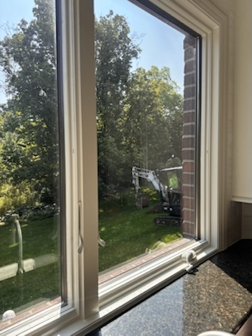

# SMS / iMessage archive — Sarah

**Source PDF:** `iphone_sarah.pdf`
**Messages represented:** 14
**Conversation:** Regina ↔ Sarah
**Order:** As exported by TextPort, earliest first
**Time zone:** Not specified in the PDF; do not assume UTC
**Evidence note:** TextPort may repeat rounded timestamps across distinct messages. No exact seconds or missing timestamps have been inferred.
**Attachment note:** Bracketed image/document descriptions are preserved, but are not the actual original attachments. The PDF may omit their content.
**Provenance:** Keep the original PDF and, preferably, the native phone export.

---

## Message 0001 — 2026-08-23 11:07
**From:** Sarah  
**To:** Regina  
**Source:** PDF page 1

https://venturi.blob.core.windows.net/ fd-4121/41-04-21-043-032.001-054/0? sv=2025-11-05&se=2026-08-24T14%3A28%3A26Z&sr=b&sp=r&rs cd=inline%3B+filename%3D%2241-04-21-043-032.001-054_0.pdf %22&sig=Pkjk%2FksOKR0sBUyefrstdAKN%2B9GIuGsqTMe8oVXVi2 w%3D

Good morning Regina and Sam! This is Sarah. I wanted to pass this info onto you so you can understand where we and Paradigm found all the info on the house. Here is the information we and Paradigm used to get our numbers and base price points. Which can be found on beacon (Johnson county), assessors office and so on. This was also the information that was passed down to us when we bought the home from the previous owners.

---

## Message 0002 — 2026-08-23 11:18
**From:** Regina  
**To:** Sarah  
**Source:** PDF page 1

Hi Sarah and good morning,

Thanks for sending this over. I swear that has to include the unfinished part of the attic.. there’s just no way the second floor is more square footage than the rest of the floors. So weird..  the tax assessors measure the square footage from the outside is Sam’s understanding but he could be wrong. We are gonna get it measured to see though.

8,555 and 6,702 is just such a big difference. We feel like it’s somewhat in the middle of those numbers.

---

## Message 0003 — 2026-08-23 12:06
**From:** Regina  
**To:** Sarah  
**Source:** PDF page 1

Question… How often did you water the hydrangeas and am I needing to do that? The ones on the right side are looking so brown, is that usual for this time of the year?

---

## Message 0004 — 2026-08-23 12:25
**From:** Sarah  
**To:** Regina  
**Source:** PDF page 2

I never watered any of the perennial landscaping.  You really shouldn't have to at all. Ever. I have never seen them brown like this though. I'm not sure if you heard about the historical rain falls we had last week. It made the national news. But the weeks before the rain we had a bit of a drought. They weren't looking good then but then we got the rain last week and they turned brown. So I think its been the extreme weather. Every year prior they have been absolutely beautiful from spring into early fall. Don't worry about it. In a few weeks trim them back and I bet you anything they'll come back next spring just fine.

* I will say if you have extreme heat and no water for a week you do need to water the little evergreens that line the road, the pecan tree which is also not very old and the tree that is right next to John's road right next to his hill. Those trees are younger and don't have a deep established root system to reach water in times of drought. So I'd baby them a couple more years in times of drought. Other than that you shouldn't have to water anything. Everything else is established. If you want I can walk the property with you and go over all the trees with you. Pruning etc.

---

## Message 0005 — 2026-08-23 13:31
**From:** Sarah  
**To:** Regina  
**Source:** PDF page 2

*also the deer have been eating them this year. My daughter who's the LA suspects it the excess water they got this year

---

## Message 0006 — 2026-08-23 14:59
**From:** Regina  
**To:** Sarah  
**Source:** PDF page 2

That makes sense. Thank you! I have some landscapers coming soon to help keep the property kept up while we are in between here and Florida till we can get officially moved in so this information will be helpful to pass along to them. I would love to walk the property with you but don’t feel obligated if you are busy with getting settled in yalls new place.

---

## Message 0007 — 2026-08-24 11:03
**From:** Regina  
**To:** Sarah  
**Source:** PDF page 2

Is there an irrigation system for the yard?

---

## Message 0008 — 2026-08-24 11:05
**From:** Sarah  
**To:** Regina  
**Source:** PDF page 3

Like sprinklers?

---

## Message 0009 — 2026-08-24 11:05
**From:** Regina  
**To:** Sarah  
**Source:** PDF page 3

Yes but Derrick said no.

---

## Message 0010 — 2026-08-24 11:06
**From:** Sarah  
**To:** Regina  
**Source:** PDF page 3

Correct.

---

## Message 0011 — 2026-08-24 11:12
**From:** Regina  
**To:** Sarah  
**Source:** PDF page 3

---

## Message 0012 — 2026-08-24 11:12
**From:** Regina  
**To:** Sarah  
**Source:** PDF page 3

Plumbers were wondering, thank you both for your quick responses

---

## Message 0013 — 2026-08-24 16:58
**From:** Regina  
**To:** Sarah  
**Source:** PDF page 3

Got it all changed over and handled. Thank you for the heads up.

---

## Message 0014 — 2026-09-29 09:33
**From:** Sarah  
**To:** Regina  
**Source:** PDF page 4

Hey neighbor! Hope you had a great trip and are doing well! I picked up our package off your front porch and I dropped off some paint that should have stayed with the house. Not sure how it got put with our things.  I'm sure we'll find more things when we get into our pods. The previous owners still haven't moved out so that may be some time from now. The paint I dropped off is an exterior paint for all the outside trim, garage doors, stucko, pillars etc.
